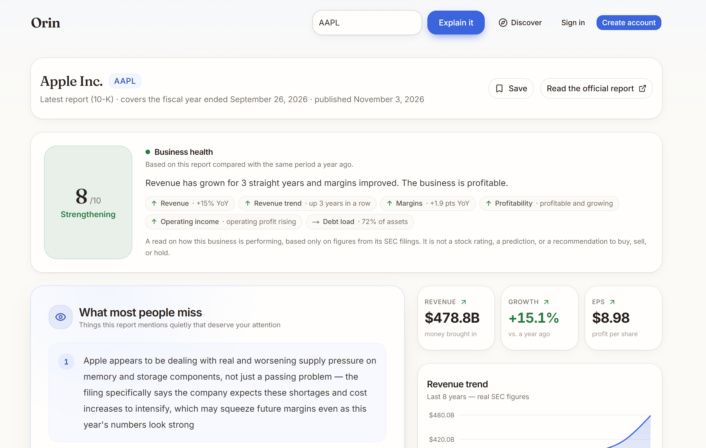

# Orin

Plain-English breakdowns of SEC 10-K and 10-Q filings for retail investors.

**Live:** https://readorin.com



## What it does

Type a ticker and Orin pulls the company's latest 10-K or 10-Q from SEC EDGAR, extracts the real financial figures, and explains them in language a first-time investor can follow.

- **Plain-English breakdown** of the filing: headline numbers (revenue with year-over-year change, net income, diluted EPS, operating income, gross margin, total assets and liabilities), a revenue trend chart, a short summary, and the notable changes.
- **"What most people miss"**: specific risks, caveats and soft spots drawn from the filing's own Risk Factors, MD&A and notes. These are the things buried late in the document or mentioned only in passing.
- **Business Health score**: a deterministic 1–10 read on how the business is trending, with the factors behind it shown.
- **Discovery feed**: 42 well-known large caps sorted by most recent filing, so you can browse new reports.
- **Saved portfolio**: sign in to save companies to a dashboard that shows each one's health score at a glance and flags when a newer filing is out.

## How it works

```
ticker → CIK → latest 10-K/10-Q → XBRL company facts → normalized metrics → Claude prose
```

1. **Resolve the filing.** The ticker is mapped to its SEC CIK, and the submissions index gives the latest 10-K or 10-Q. All EDGAR calls go through one client that sets the required `User-Agent` and spaces requests 150 ms apart, under the SEC's 10 requests per second limit.
2. **Extract the numbers.** Figures come from EDGAR's XBRL company facts, which are inconsistent from company to company, so extraction handles that explicitly:
   - **Per-company tagging.** Each metric has an ordered fallback list of XBRL concepts. Revenue, for example, tries `Revenues`, then `RevenuesNetOfInterestExpense` (banks), then the ASC 606 contract-revenue tags, and so on.
   - **Amended and duplicate facts.** The same period reappears across original filings, later comparatives and amendments. Orin keeps the most recently filed value, so restatements win.
   - **Period matching.** Facts are matched by their duration (a quarter or a fiscal year), with windows wide enough for 52/53-week fiscal calendars. Year-over-year comparisons use the same concept tag as the current figure.
   - **Missing data shows "not reported."** No figure is ever estimated. Gross margin is calculated only from reported gross profit or cost of revenue, and is otherwise "not reported" (banks and REITs, for example).
3. **Write the prose, without inventing numbers.** Claude receives the extracted figures, already formatted, along with relevant filing text. It is told to use only those figures, verbatim. After it responds, every number in its output is checked against the figures and the filing text. If any number fails that check, the summary is withheld and only the extracted figures are shown.

### Business Health score

This is a deterministic 1–10 score computed from the extracted metrics. No language model is involved, so the same filing always gets the same score. Six weighted signals feed it:

| Signal | Weight |
|---|---|
| Revenue growth (YoY) | 0.26 |
| Profitability (level and direction) | 0.22 |
| Margin direction | 0.18 |
| Operating income direction | 0.12 |
| Leverage (liabilities / assets) | 0.12 |
| Revenue trend consistency | 0.10 |

- If a signal can't be computed, it's dropped and the remaining weights are renormalized.
- If too little data is left, Orin says "not enough data" instead of showing a number.
- A profitability floor keeps a company whose losses are widening from ever reading as "Steady."
- The explanation sentence is assembled from the computed factors, not generated by a model.

The scoring logic is in [`lib/health/score.ts`](lib/health/score.ts).

## Correctness testing

[`scripts/verify.ts`](scripts/verify.ts) runs the full extraction for each ticker, then downloads the actual filing from sec.gov. It confirms every extracted figure appears in that document as presented, allowing for thousands or millions scaling and parentheses for negatives. The five test companies were chosen because each one breaks a different assumption:

| Ticker | Company | What it tests |
|---|---|---|
| AAPL | Apple | Clean large-cap baseline; 52/53-week fiscal year; switched revenue tags over time |
| JPM | JPMorgan Chase | Bank income statement: revenue net of interest expense, no gross margin or operating income |
| WMT | Walmart | Retailer with membership income (revenue lives under `Revenues`, not contract revenue); 52/53-week fiscal calendar |
| RIVN | Rivian | Unprofitable: negative net income and EPS, so the signs have to be right |
| O | Realty Income | REIT with non-standard net-income tagging and no operating income line |

```bash
node --env-file=.env.local scripts/verify.ts AAPL JPM WMT RIVN O
```

## Production hardening

- **Caching keyed on the filing's accession number.** Analyses are cached in Supabase per filing. A repeat lookup of the same filing returns instantly and skips the Claude call. When a company files a new report, its accession number changes, so the cache invalidates itself. Only fully successful results are cached.
- **Per-IP rate limiting.** A sliding window limits each IP to 10 uncached analyses per 5 minutes. Cache hits never count against the limit.
- **Concurrent-request de-duplication.** If several requests arrive for the same uncached filing at once, they share one analysis instead of each starting its own Claude call.
- **Server-side input validation.** Tickers are validated in the API route and in the server actions. Server actions also check the type and length of every field, since TypeScript types aren't enforced at runtime.
- **Data isolation.** Saved portfolios are protected by Postgres Row Level Security, keyed on the Clerk user ID from the session token. The service-role client is marked `server-only`, so the build fails if it's ever imported into browser code.

## Tech stack

Next.js (App Router) · TypeScript · Tailwind CSS + shadcn/ui · Supabase (Postgres + RLS) · Clerk · Anthropic Claude API · Recharts · Vercel

## Running locally

Requires Node 22.18+, which can run the TypeScript scripts directly. You also need a Supabase project, a Clerk application and an Anthropic API key.

1. Install dependencies and create your env file:

   ```bash
   npm install
   cp .env.example .env.local
   ```

   Fill in `.env.local`. Every variable has a comment in [`.env.example`](.env.example).

2. In the Supabase SQL editor, run the files in `supabase/` in this order: `schema.sql`, `saved_stocks.sql`, `cache.sql`, `feed_cache.sql`, `rls_update.sql`. Then add Clerk as a third-party auth provider in Supabase so RLS can read the Clerk user ID.

3. Start the dev server:

   ```bash
   npm run dev
   ```

The extraction pipeline also runs from the command line:

```bash
node --env-file=.env.local scripts/extract.ts AAPL     # print the extracted snapshot
node --env-file=.env.local scripts/summarize.ts AAPL   # snapshot + Claude summary + number check
```

## Disclaimer

Orin is an educational tool for understanding company filings. It is not investment advice. Figures come from SEC EDGAR as reported; always check the original filing.
